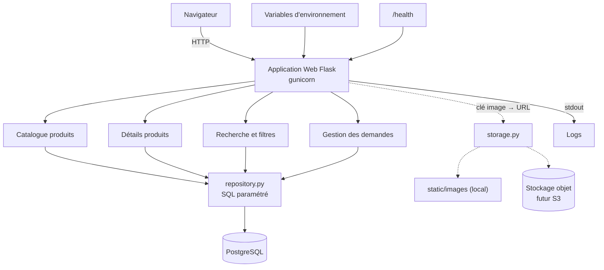
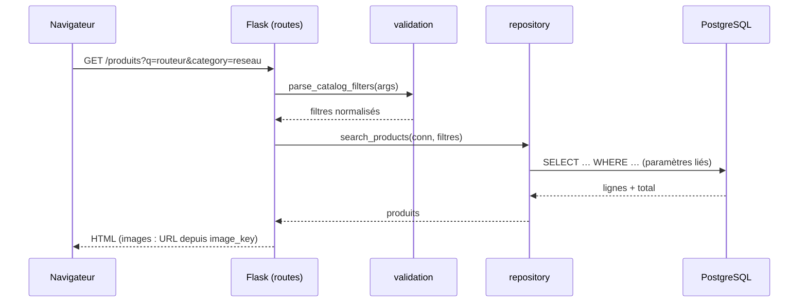
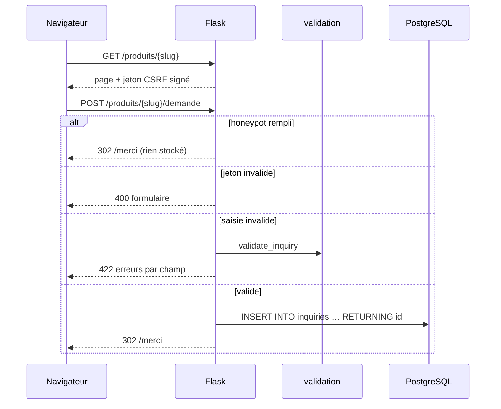
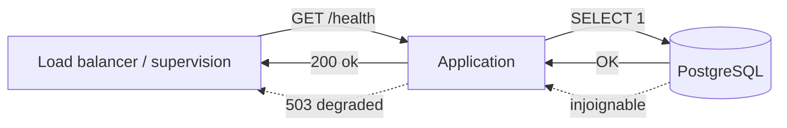

# Diagrammes d'architecture applicative

## Vue d'ensemble



Version texte :

```text
Navigateur
    │
    ▼
Application Web (Flask)  ◄── variables d'environnement (config)
    │                    ──► logs (stdout)
    ├── Catalogue produits ─┐
    ├── Détails produits    ├──► repository.py ──► PostgreSQL
    ├── Recherche           │
    └── Gestion des demandes┘
    │
    └── storage.py : image_key ──► /static/images/<clé>   (local)
                                   <ASSET_BASE_URL>/<clé>  (S3 plus tard)
```

## Séquence : consultation du catalogue



## Séquence : envoi d'une demande client



## Santé


