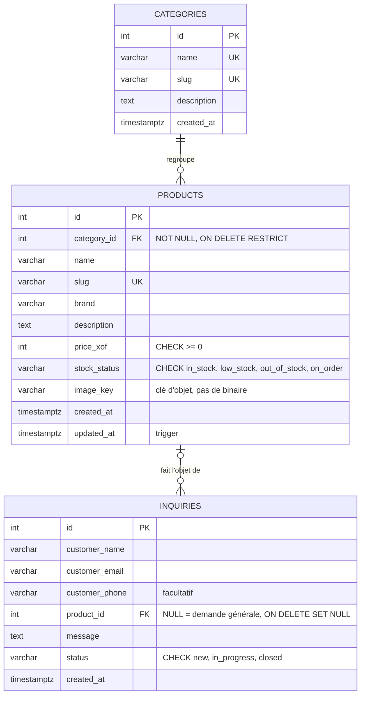

# Diagramme entité-relation



Version texte :

```text
┌────────────┐ 1      N ┌──────────────┐ 1      N ┌─────────────┐
│ categories │─────────<│   products   │─────────<│  inquiries  │
│ id  PK     │          │ id  PK       │          │ id  PK      │
│ name  UK   │          │ category_id  │ FK       │ product_id  │ FK, nullable
│ slug  UK   │          │   FK NOT NULL│          │ customer_*  │
│ description│          │ slug  UK     │          │ message     │
└────────────┘          │ price_xof    │          │ status      │
                        │ stock_status │          │ created_at  │
                        │ image_key ───┼─► objet  └─────────────┘
                        └──────────────┘   (fichier / S3)
```

## Lecture du diagramme

- Une **catégorie** contient de zéro à plusieurs **produits** ; un produit a **exactement une** catégorie.
- Un **produit** peut recevoir zéro à plusieurs **demandes** ; une demande concerne **zéro ou un** produit (`NULL` = contact général).
- `image_key` n'est pas une relation de base de données : c'est une **référence logique** vers un objet stocké hors base.

## Index

| Table | Index | Colonnes |
|---|---|---|
| categories | PK, UK | `id`, `name`, `slug` |
| products | PK, UK | `id`, `slug` |
| products | `idx_products_category_id` | `category_id` |
| products | `idx_products_stock_status` | `stock_status` |
| products | `idx_products_price` | `price_xof` |
| inquiries | PK | `id` |
| inquiries | `idx_inquiries_product_id` | `product_id` |
| inquiries | `idx_inquiries_status_created` | `status, created_at DESC` |
